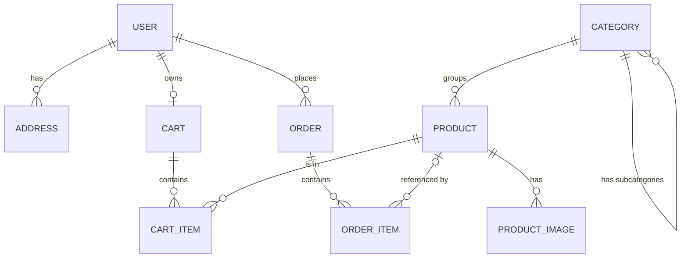

# Database

Firshop uses PostgreSQL. Tables are created by Django migrations
(`python manage.py migrate`).

## Relationships

## Tables

### User (`users`)
| Field | Type | Notes |
|---|---|---|
| username, email | text | email is unique |
| first_name, last_name | text | |
| phone | text | optional |
| is_staff | boolean | can access the admin |

### Address (`users`)
| Field | Type | Notes |
|---|---|---|
| user | FK to User | deleted with the user |
| full_name, phone, street, city, postal_code, country | text | |
| is_default | boolean | |

### Category (`products`)
...

### Product (`products`)
...

### ProductImage (`products`)
...

### Cart and CartItem (`cart`)
...

### Order and OrderItem (`orders`)
...
